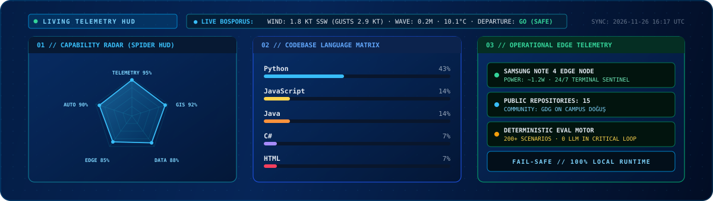

<!-- AERO GLASS ACTION BAR -->

  

<!-- QUICK JUMP TELEMETRY BAR -->
<code>[ <a href="#flagship">01_MARITIME_WATCH</a> ]</code> ·
<code>[ <a href="#fleet">02_SOFTWARE_FLEET</a> ]</code> ·
<code>[ <a href="#platforms">03_CO_BUILT_PLATFORMS</a> ]</code> ·
<code>[ <a href="#telemetry">04_LIVING_TELEMETRY</a> ]</code> ·
<code>[ <a href="#stack">05_TECH_REEF</a> ]</code> ·
<code>[ <a href="#connect">06_CONNECT</a> ]</code>

  

<!-- THE CONTINUOUS LIVING OCEAN (V9 ULTRA) -->

  

<!-- REAL-TIME BOSPHORUS & DEVELOPER TELEMETRY HUD -->

  

<!-- LIVING CONTRIBUTION STREAM -->
<picture>
  <source media="(prefers-color-scheme: dark)" srcset="output/github-contribution-grid-snake.svg" />
  
</picture>

  

<!-- STATS & PROFILE SIGNAL BADGES -->

  

 

<!--
  ATS & RECRUITER EXECUTIVE SPECIFICATIONS
-->

  
<b>🔍 Click to expand Plain Text & ATS Executive Specifications</b>

   

### 👤 Profile Overview
- **Name:** Kerem Kalyoncu
- **Role:** Software Engineer
- **Location:** İstanbul, Türkiye (41.0082° N, 28.9784° E)
- **Education:** Doğuş University — Software Engineering, BSc (2023 — 2027)
- **Leadership:** GDG on Campus Doğuş — Design & Social Media Team Lead
- **Training:** Huawei × AI Academy (Data Science & Machine Learning), BTK AI Fundamentals

---

### 🚢 Key Engineering Projects
1. **[Maritime Watch Türkiye](https://keremkalyoncu.github.io/maritime-watch)** *(Live Production System)*
   - Translates multi-source weather forecasts, real-time AIS telemetry, and Turkish navigational warnings into vessel-specific departure decisions (`Go / Caution / No-Go`).
   - *Stack:* Python, Leaflet.js, Open-Meteo, PWA, Edge Computing.
2. **[Inventra](https://x-etc.online)** *(Cloud Workforce & Inventory Platform)*
   - Full enterprise workflow platform for staff management, inventory auditing, and operational pipelines.
   - *Stack:* ASP.NET Core, React, Material UI, PostgreSQL.
3. **[Restofy](https://github.com/software-lecture-labs/Restofy)** *(Restaurant Microservices)*
   - Scalable QR menu and order dispatching backend built for high concurrency.
   - *Stack:* Java, Spring Boot, Microservices, Docker.
4. **[KriptoParaTakip](https://github.com/KeremKalyoncu/KriptoParaTakip)** *(Financial Market Engine)*
   - Live telemetry, price tracking, and automated volatility alerts.
   - *Stack:* Java, REST APIs, Desktop GUI, JSON Pipelines.
5. **[Shifha](https://www.linkedin.com/in/kerem-kalyoncu/)** *(Clinical AI Protocol)*
   - Collaborative medical information routing and automated clinician decision support.
   - *Stack:* React Native, Python, Medical NLP.

---

### ⚙️ Core Technical Constellation
- **Backend & Systems:** Java, Spring Boot, C#, ASP.NET Core, Python, REST APIs, Microservices.
- **Web & Interface:** TypeScript, React, Next.js, HTML5/CSS3, Frutiger Aero Vector Design, Leaflet.js.
- **Data & Intelligence:** Python, Pandas, NumPy, scikit-learn, SQLite, DuckDB, Machine Learning Pipelines.
- **Delivery & DevOps:** Docker, PostgreSQL, GitHub Actions, Linux/Bash, Continuous Integration (CI/CD).

---

### 📬 Connect & Channels
- **GitHub:** [github.com/KeremKalyoncu](https://github.com/KeremKalyoncu)
- **LinkedIn:** [linkedin.com/in/kerem-kalyoncu](https://www.linkedin.com/in/kerem-kalyoncu/)
- **Live Interactive Experience:** [keremkalyoncu.github.io/KeremKalyoncu](https://keremkalyoncu.github.io/KeremKalyoncu)

 

  Engineered with deterministic precision & Frutiger Aero aesthetics · Kerem Kalyoncu © 2026

