<!-- KEREM / AERO v5 | Visual GitHub profile: accessible descriptions via alt text. -->

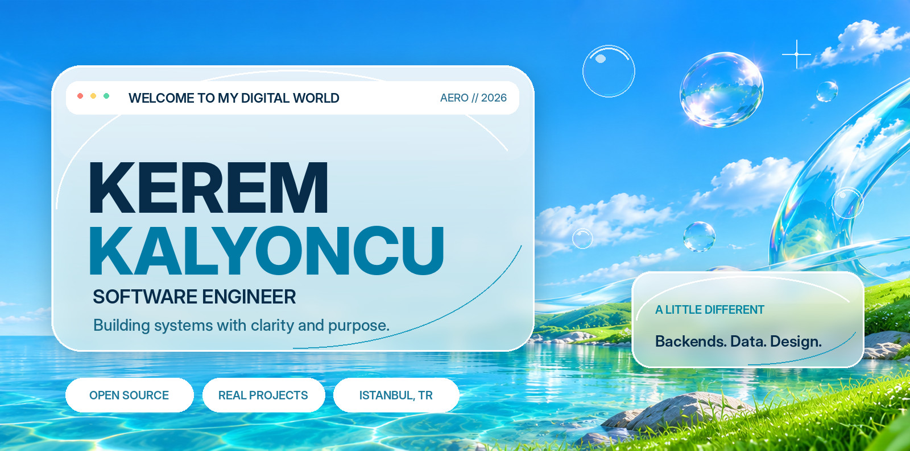
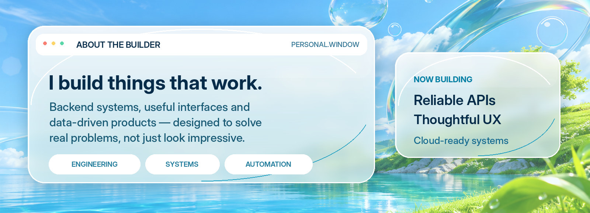
<a href="https://github.com/KeremKalyoncu/maritime-watch">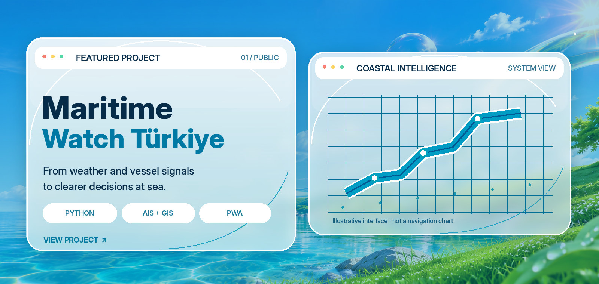</a>
<a href="https://github.com/software-lecture-labs/Restofy">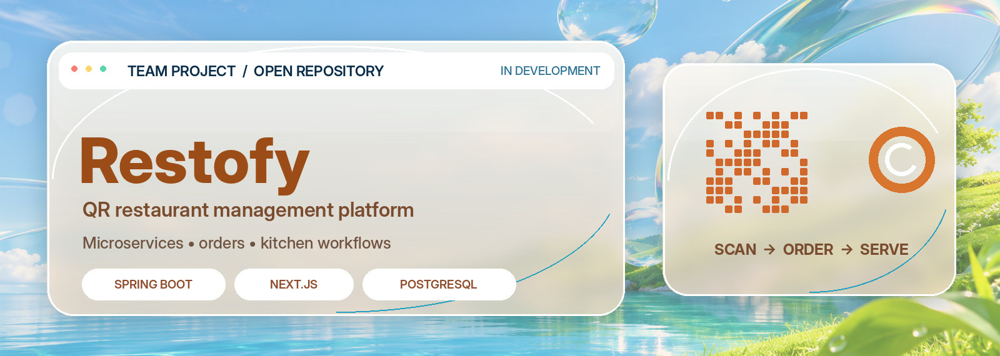</a>
<a href="https://github.com/KeremKalyoncu/KriptoParaTakip">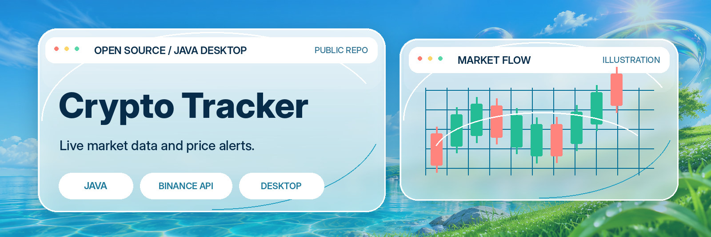</a>
<a href="https://github.com/KeremKalyoncu/ml-final-odev">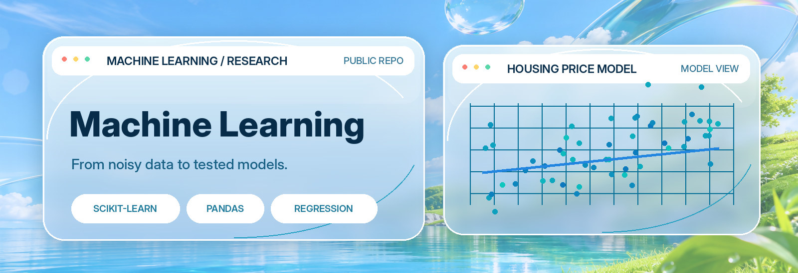</a>
<a href="https://github.com/KeremKalyoncu/ml-ara-odev">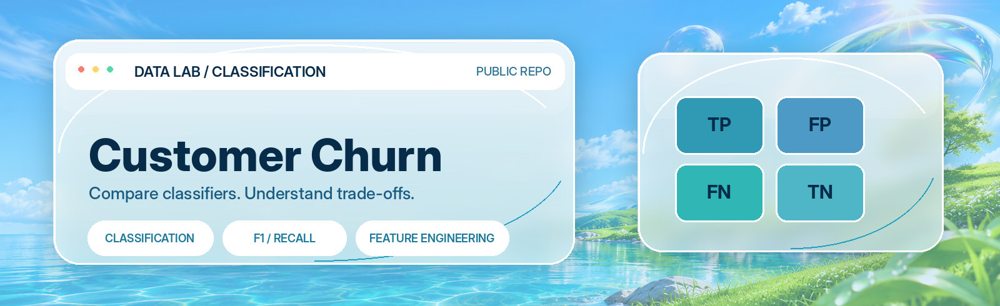</a>
<a href="https://github.com/KeremKalyoncu/Gelismis_Kutuphane_Sistemi">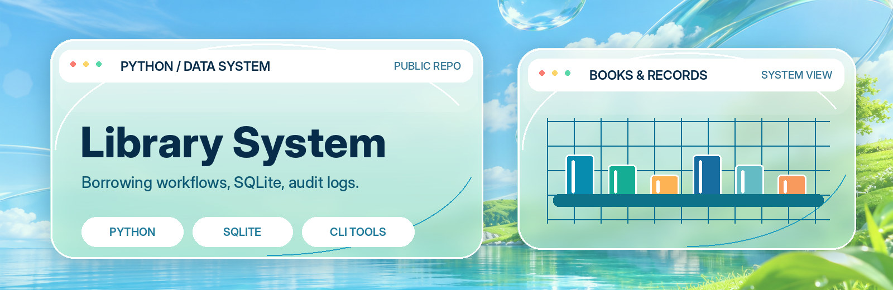</a>
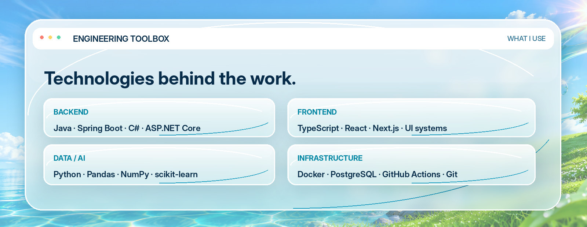
<a href="https://vollsign.com">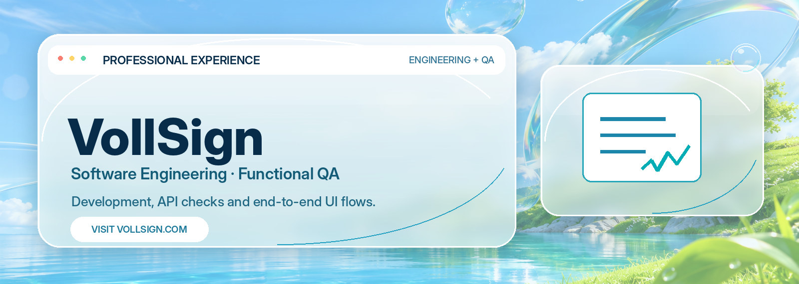</a>
<a href="https://github.com/KeremKalyoncu?tab=repositories">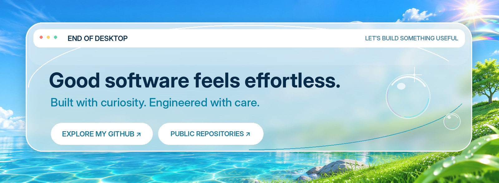</a>

