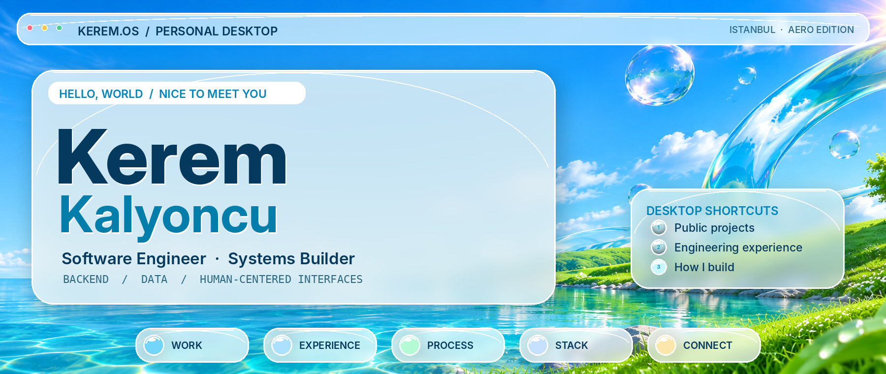
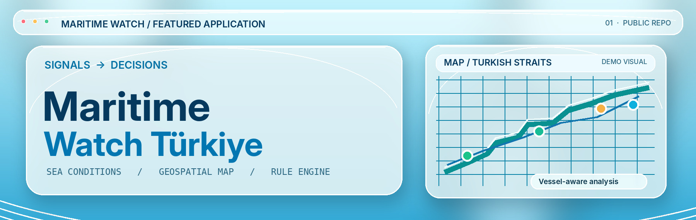
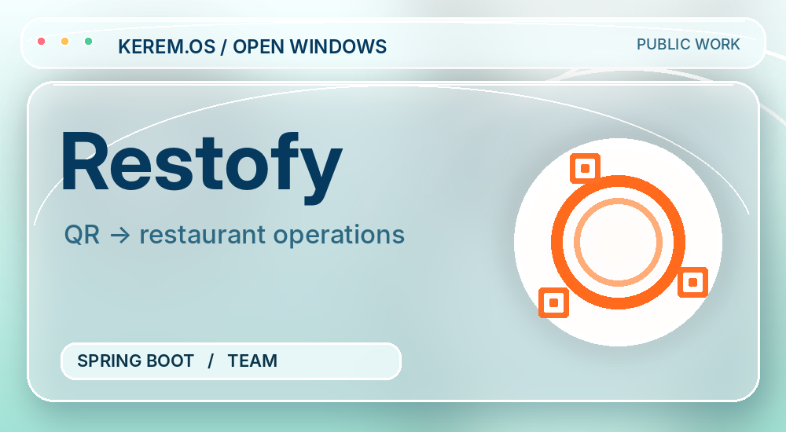
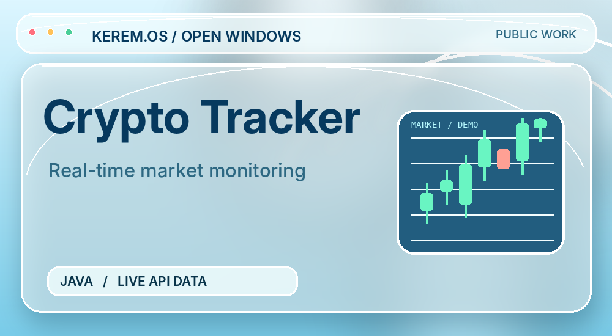
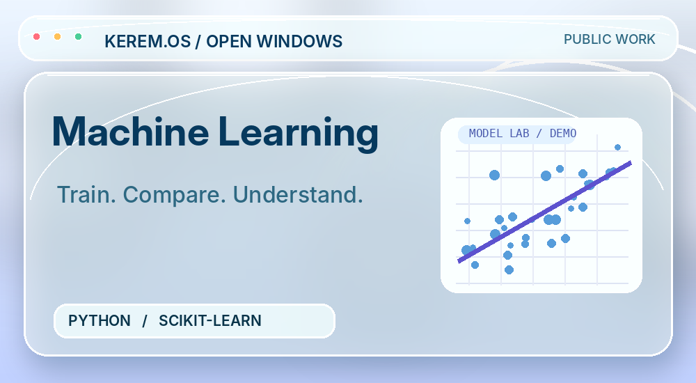
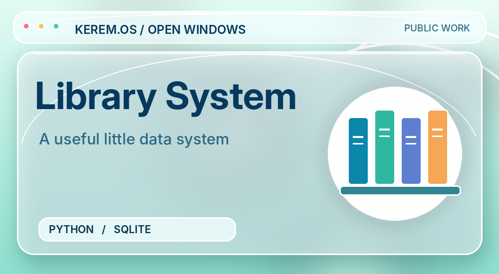
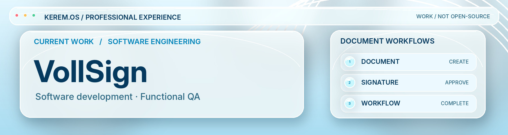
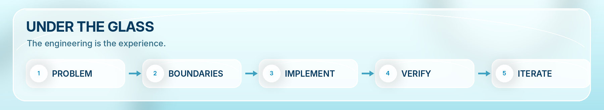
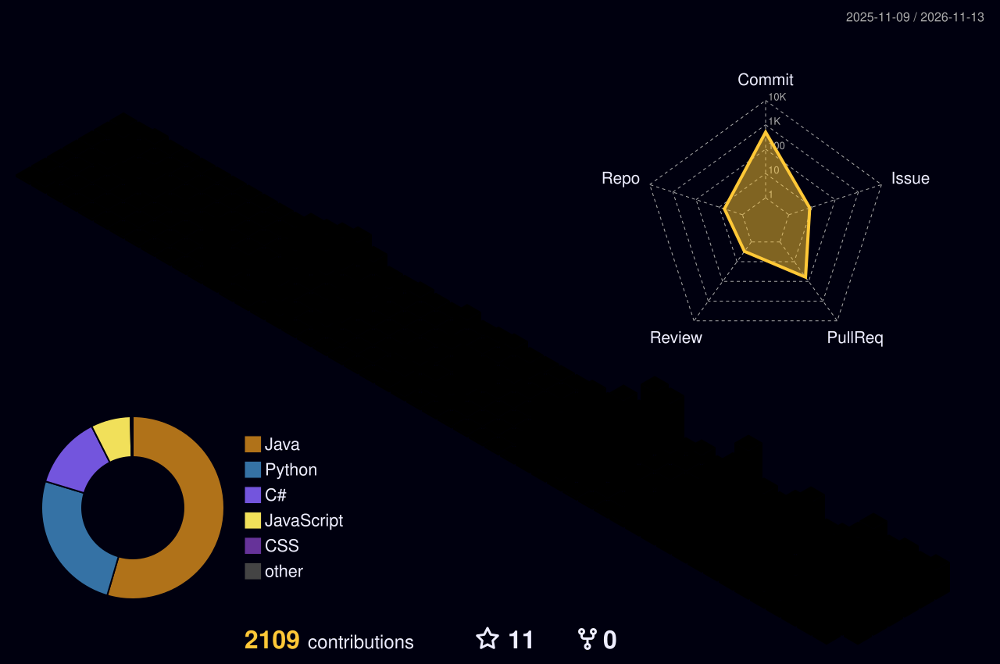

### Building the backend *and* the experience.

I enjoy turning messy problems into useful software — with reliable foundations and a little more sunlight in the interface.

**[Explore my work](#selected-work)** &nbsp; · &nbsp; **[Engineering experience](#experience)** &nbsp; · &nbsp; **[How I build](#how-i-build)** &nbsp; · &nbsp; **[Say hello](#connect)**

01 / ABOUT &nbsp; · &nbsp; 02 / FEATURED &nbsp; · &nbsp; 03 / OPEN WINDOWS &nbsp; · &nbsp; 04 / EXPERIENCE &nbsp; · &nbsp; 05 / PROCESS &nbsp; · &nbsp; 06 / TOOLBOX &nbsp; · &nbsp; 07 / ACTIVITY

---

## 01 / The person behind the glass

Hey! I'm **Kerem Kalyoncu** — a software engineer in **İstanbul, Türkiye**, currently in my final year of Software Engineering.

My favorite place to work is where **backend architecture, data, and human-centered interfaces** meet. I build APIs, connect services, work with data, test the behavior, and pay attention to what using the final product actually feels like.

I have a soft spot for **Frutiger Aero**: optimistic technology, translucent glass, wide-open skies, and playful interfaces. But the visual style is only the surface. Underneath it, I care about **clear code, sound system boundaries, explicit failure states, and practical results**.

| **What I build** | **What I care about** | **What I'm exploring** |
| :--- | :--- | :--- |
| Backend systems, data products, developer tools, interactive web experiences | Architecture, testability, clarity, maintainability, usable interfaces | Python, Go, AI-assisted engineering, reliable automation |

## 02 / Featured application

### [Maritime Watch Türkiye](https://github.com/KeremKalyoncu/maritime-watch) &nbsp; · &nbsp; [Live map](https://keremkalyoncu.github.io/maritime-watch)

**From weather data to a decision someone can use.** Raw forecasts may tell a small-craft operator the wind and wave height, but not how the conditions could affect a particular journey. Maritime Watch combines public marine forecasts, maritime signals, and map-based context into understandable, vessel-oriented **decision-support information** for Turkish waters.

- **The engineering:** Python-based data pipelines, geospatial presentation, deterministic safety thresholds, operational bulletins, and clear handling of unavailable data.
- **The design challenge:** reducing several noisy data sources to a readable interface without pretending that the system knows more than its inputs.
- **The interesting constraint:** a critical decision path should be inspectable and rule-based, rather than dependent on a generative model's guesses.

**[Open the application](https://keremkalyoncu.github.io/maritime-watch)** · **[Read the source](https://github.com/KeremKalyoncu/maritime-watch)** · **[Project documentation](https://github.com/KeremKalyoncu/maritime-watch#readme)**

Maritime Watch provides informational decision support. It is not an official navigational, safety, or rescue authority. The map in the banner is an illustration, not live telemetry.

## 03 / Open windows — selected public work

Different projects, different problems. These are public repositories you can actually explore, including a collaborative team project.

<table>
<tr>
<td width="50%" valign="top">

### [Restofy](https://github.com/software-lecture-labs/Restofy)
**Collaborative / public organization repository**

A QR-based restaurant management platform being developed around a **Spring Boot microservice architecture**, with digital menu, ordering, and operational workflows.

**My contribution:** authentication and email-related backend development, with attention to APIs and service boundaries.

`Java` · `Spring Boot` · `PostgreSQL` · `Next.js`

[View team repository](https://github.com/software-lecture-labs/Restofy)

</td>
<td width="50%" valign="top">

### [KriptoParaTakip](https://github.com/KeremKalyoncu/KriptoParaTakip)
**Personal / public repository**

A Java desktop application that reads market data through the **Binance API**, monitors selected cryptocurrencies, and provides audible price-change alerts.

**Engineering focus:** external API integration, continuous updates, desktop UI, and user-configured watchlists.

`Java` · `Desktop GUI` · `API integration`

[View source](https://github.com/KeremKalyoncu/KriptoParaTakip)

</td>
</tr>
<tr>
<td width="50%" valign="top">

### [Machine Learning Lab](https://github.com/KeremKalyoncu/ml-final-odev)
**Personal / public experiments**

Two practical studies: **California housing-price regression** and **customer churn classification** using generated sample data. They cover preprocessing, feature engineering, model evaluation, and interpreting the tradeoffs behind a metric.

**Engineering focus:** experiments, validation, reproducible comparisons, and explaining model limitations.

`Python` · `Pandas` · `scikit-learn`

[Housing-price regression](https://github.com/KeremKalyoncu/ml-final-odev) · [Churn classification](https://github.com/KeremKalyoncu/ml-ara-odev)

</td>
<td width="50%" valign="top">

### [Library Management System](https://github.com/KeremKalyoncu/Gelismis_Kutuphane_Sistemi)
**Personal / public repository**

A Python command-line application for managing a small library: book records, borrowing and returns, **SQLite** persistence, and logs that make actions traceable.

**Engineering focus:** data modeling, durable storage, transactional workflows, and maintainable CLI logic.

`Python` · `SQLite` · `Logging`

[View source](https://github.com/KeremKalyoncu/Gelismis_Kutuphane_Sistemi)

</td>
</tr>
</table>

<b>More public projects in the archive</b>

- **[Fuel Station Automation](https://github.com/KeremKalyoncu/Benzin_Istasyonu_Otamasyon)** — a C# Windows Forms app for daily operations, stock and sales.
- **[QRKodder](https://github.com/KeremKalyoncu/QRKodder)** — Java QR-code generation and reading with ZXing.
- **[Titanic Data Analysis](https://github.com/KeremKalyoncu/Titanic_Veri_Analizi)** — exploratory data analysis and visualizations.
- **[Inventory Stock Tracking](https://github.com/KeremKalyoncu/Envanter-Stok-Takibi)** — a lightweight Python inventory tool.

**[Browse every public repository](https://github.com/KeremKalyoncu?tab=repositories)**

## 04 / Professional experience

### Software Engineer · [VollSign](https://vollsign.com)

VollSign develops software for digital document and legal-workflow management. I work across **software development and functional quality assurance**, reviewing user flows, interface behavior, API interactions, and integration outcomes.

I value this side of engineering: checking not just whether a feature is implemented, but whether it behaves consistently for the people using it.

**[VollSign official website](https://vollsign.com)**

Professional work is shown as experience, not presented as publicly available personal source code. Illustrations are conceptual and do not depict a private product interface.

### Beyond the code

I also contribute to student developer communities through **GDG on Campus Doğuş**, where technical learning meets communication, events, and collaborative work.

## 05 / Under the glass — my engineering loop

**A nice interface earns attention. A dependable system earns trust.** My process tries to support both:

1. **Understand the actual problem.** A feature list is not a product goal.
2. **Define boundaries deliberately.** APIs, service ownership, contracts, and dependencies need to make sense.
3. **Build readable software.** Prefer understandable implementations over clever-looking complexity.
4. **Verify real behavior.** Test important flows, failures, integrations, and edge cases.
5. **Improve with evidence.** Logs, reproducible bugs, and observed outcomes should inform changes.

## 06 / The toolbench

| **Layer** | **Technologies** |
| :--- | :--- |
| **Backend and API engineering** | `Java` · `Spring Boot` · `C#` · `ASP.NET Core` · `REST` |
| **Data and machine learning** | `Python` · `SQL` · `Pandas` · `NumPy` · `scikit-learn` |
| **Web and interaction** | `TypeScript` · `JavaScript` · `React` · `Next.js` · `HTML` · `CSS` |
| **Databases and delivery** | `PostgreSQL` · `SQLite` · `Docker` · `Git` · `GitHub Actions` |
| **Currently exploring** | `Go` · reliable AI-assisted development · developer tooling |

The languages and frameworks above reflect my broader engineering experience; not every one appears in a public personal repository.

## 07 / Contribution landscape

I prefer meaningful engineering work to invented skill percentages. If you enjoy visual GitHub activity, here are two generated views maintained by my existing profile workflows:

<strong>Open the contribution stream</strong>

<strong>Open the 3D contribution landscape</strong>

## 08 / Aero guestbook

You can leave a quick greeting without sending me a message elsewhere. The link opens a **GitHub Issue**; once the included GitHub Actions workflow is installed and permitted to write, it records the greeting here and closes the issue. GitHub login is required.

**[Leave a greeting in the Aero guestbook](https://github.com/KeremKalyoncu/KeremKalyoncu/issues/new?title=%5BAERO-HELLO%5D%20Hello%20from%20GitHub&body=Hi%20Kerem%21%20I%20found%20your%20Aero%20desktop%20profile.)**

<!-- AERO_GUESTBOOK_START -->
| UTC | Visitor | Message |
| :--- | :--- | :--- |
| — | — | Waiting for the first greeting |
<!-- AERO_GUESTBOOK_END -->

The guestbook shows verified GitHub issue events, not simulated commands, fabricated response times, or fake hardware health checks.

## 09 / Connect

I enjoy talking about **backend architecture, data, useful automation, developer experience, and expressive interfaces**. If you're working on something interesting, I'd love to hear about it.

**[GitHub](https://github.com/KeremKalyoncu)** &nbsp; · &nbsp; **[LinkedIn](https://www.linkedin.com/in/kerem-kalyoncu-0753k)** &nbsp; · &nbsp; **[Explore public code](https://github.com/KeremKalyoncu?tab=repositories)**

A little nostalgia in the pixels. Careful engineering under the glass.

