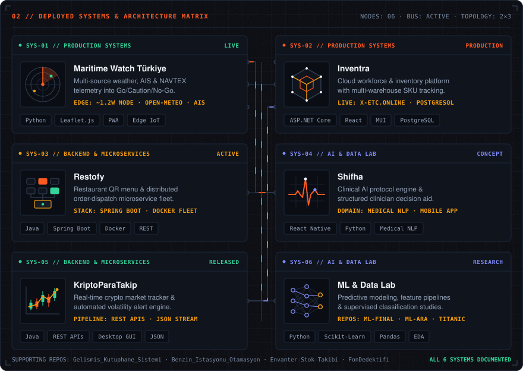

  <strong><a href="https://keremkalyoncu.github.io/KeremKalyoncu/">Interactive Companion Site ↗</a></strong>
  &nbsp;·&nbsp;
  <a href="https://github.com/KeremKalyoncu">GitHub</a>
  &nbsp;·&nbsp;
  <a href="https://www.linkedin.com/in/kerem-kalyoncu/">LinkedIn</a>

  

  

  

  <a href="https://keremkalyoncu.github.io/maritime-watch">Maritime Watch</a>
  &nbsp;·&nbsp;
  <a href="https://x-etc.online">Inventra</a>
  &nbsp;·&nbsp;
  <a href="https://github.com/software-lecture-labs/Restofy">Restofy</a>
  &nbsp;·&nbsp;
  <a href="https://www.linkedin.com/in/kerem-kalyoncu/">Shifha</a>
  &nbsp;·&nbsp;
  <a href="https://github.com/KeremKalyoncu/KriptoParaTakip">KriptoParaTakip</a>
  &nbsp;·&nbsp;
  <a href="https://github.com/KeremKalyoncu/ml-final-odev">ML &amp; Data Lab</a>

  
<strong>ATS / Recruiter Specification — Plain-Text Index</strong>

### Profile
- **Name:** Kerem Kalyoncu (`KeremKalyoncu`)
- **Role:** Software Engineer · Systems, Telemetry & AI
- **Location:** İstanbul, Türkiye (`41.0082° N, 28.9784° E`)
- **Education:** Doğuş University — Software Engineering, BSc (`2023–2027`)

### Experience & Community Leadership
- **Doğuş University** — Software Engineering, BSc (`2023–2027`)
- **GDG on Campus Doğuş** ([tr.linkedin.com/company/gdg-on-campus-dogus](https://tr.linkedin.com/company/gdg-on-campus-dogus)) — Design & Social Media Team Lead (`2025–2026`)
- **Huawei × AI Academy** — Data Science & Machine Learning (`2026`)
- **BTK AI Fundamentals** — AI Fundamentals & Applied ML (`2025–2026`)
- **VollSign** ([vollsign.com](https://vollsign.com)) — Software Engineer · Dev / QA / Testing (`Experience`)

### Core Systems
1. **[Maritime Watch Türkiye](https://keremkalyoncu.github.io/maritime-watch)** *(SYS-01 · Production Systems)* — Translates multi-source marine weather forecasts, real-time AIS telemetry, and Turkish navigational warnings into deterministic Go / Caution / No-Go departure and safe-return decisions. *Stack:* Python, Leaflet.js, Open-Meteo, AIS, PWA, Edge Computing.
2. **[Inventra](https://x-etc.online)** *(SYS-02 · Production Systems)* — Enterprise cloud workforce scheduling, multi-warehouse inventory auditing, and operational workflow platform deployed in production. *Stack:* ASP.NET Core, React, Material UI, PostgreSQL.
3. **[Restofy](https://github.com/software-lecture-labs/Restofy)** *(SYS-03 · Backend & Microservices)* — Collaborative restaurant QR menu and high-concurrency order dispatching microservices architecture built with Spring Boot and Docker. *Stack:* Java, Spring Boot, Microservices, Docker.
4. **[Shifha](https://www.linkedin.com/in/kerem-kalyoncu/)** *(SYS-04 · AI & Data Lab)* — Collaborative clinical AI protocol for structured medical information routing and automated clinician decision support across mobile workflows. *Stack:* React Native, Python, Medical NLP.
5. **[KriptoParaTakip](https://github.com/KeremKalyoncu/KriptoParaTakip)** *(SYS-05 · Backend & Microservices)* — Financial market tracking engine streaming live cryptocurrency telemetry, price feeds, and automated volatility alerts in a Java desktop suite. *Stack:* Java, REST APIs, Desktop GUI, JSON Pipelines.
6. **[ML & Data Lab](https://github.com/KeremKalyoncu/ml-final-odev)** *(SYS-06 · AI & Data Lab)* — Predictive modeling and EDA pipelines covering California Housing regression with GridSearchCV, Customer Churn classification benchmarking LR/KNN/DT, and survival pattern analysis. ([ml-ara-odev](https://github.com/KeremKalyoncu/ml-ara-odev), [Titanic_Veri_Analizi](https://github.com/KeremKalyoncu/Titanic_Veri_Analizi)) *Stack:* Python, Scikit-Learn, Pandas, NumPy.

### Supporting Repositories
- [Gelismis_Kutuphane_Sistemi](https://github.com/KeremKalyoncu/Gelismis_Kutuphane_Sistemi) · [Benzin_Istasyonu_Otamasyon](https://github.com/KeremKalyoncu/Benzin_Istasyonu_Otamasyon) · [Envanter-Stok-Takibi](https://github.com/KeremKalyoncu/Envanter-Stok-Takibi) · [Dinamik-Css-Portfolyo](https://github.com/KeremKalyoncu/Dinamik-Css-Portfolyo) · `FonDedektifi` *(private)*

### Technical Stack
- **Systems & Backend:** Java, Spring Boot, C#, ASP.NET Core, Python, FastAPI, REST APIs, Microservices
- **Web & Interface:** TypeScript, React, Next.js, Material UI, Leaflet.js, HTML5 / CSS3, PWA, Vector SVG
- **AI & Data Lab:** Python, Pandas, NumPy, Scikit-Learn, SQLite, DuckDB, Medical NLP, Feature Engineering
- **Cloud & Edge:** Docker, PostgreSQL, GitHub Actions, Linux / Bash, CI/CD, Edge Node (~1.2W), Cron Telemetry

### Channels
- **Interactive Companion Site:** [keremkalyoncu.github.io/KeremKalyoncu](https://keremkalyoncu.github.io/KeremKalyoncu/)
- **GitHub:** [github.com/KeremKalyoncu](https://github.com/KeremKalyoncu)
- **LinkedIn:** [linkedin.com/in/kerem-kalyoncu](https://www.linkedin.com/in/kerem-kalyoncu/)

  KEREM KALYONCU // ISTANBUL SYSTEMS & AI · Kerem Kalyoncu © 2026

